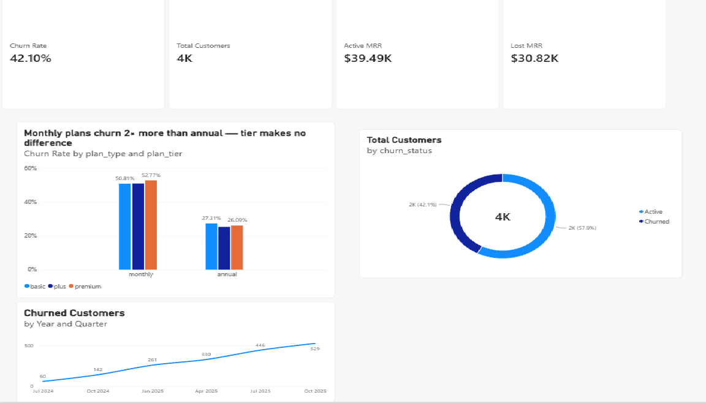
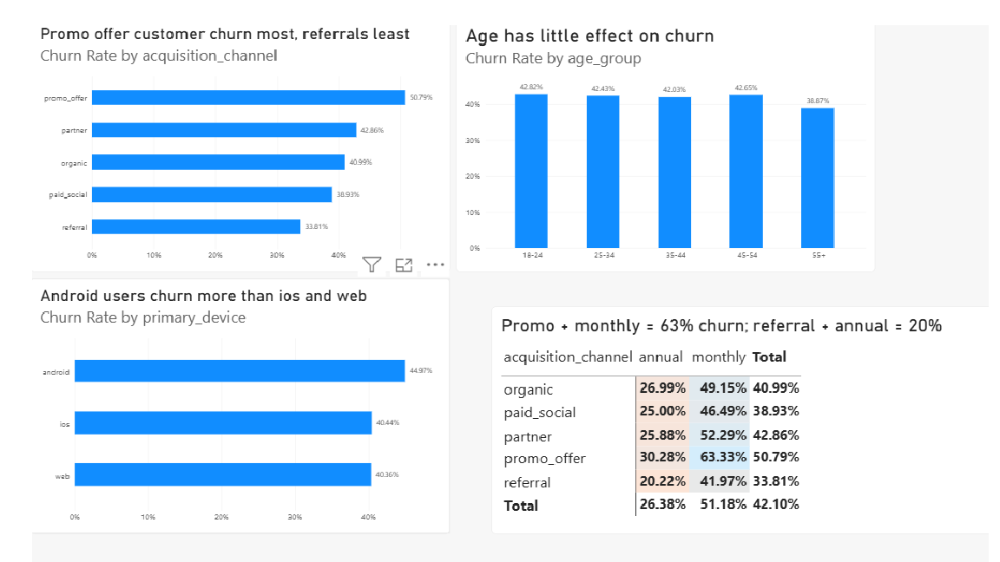
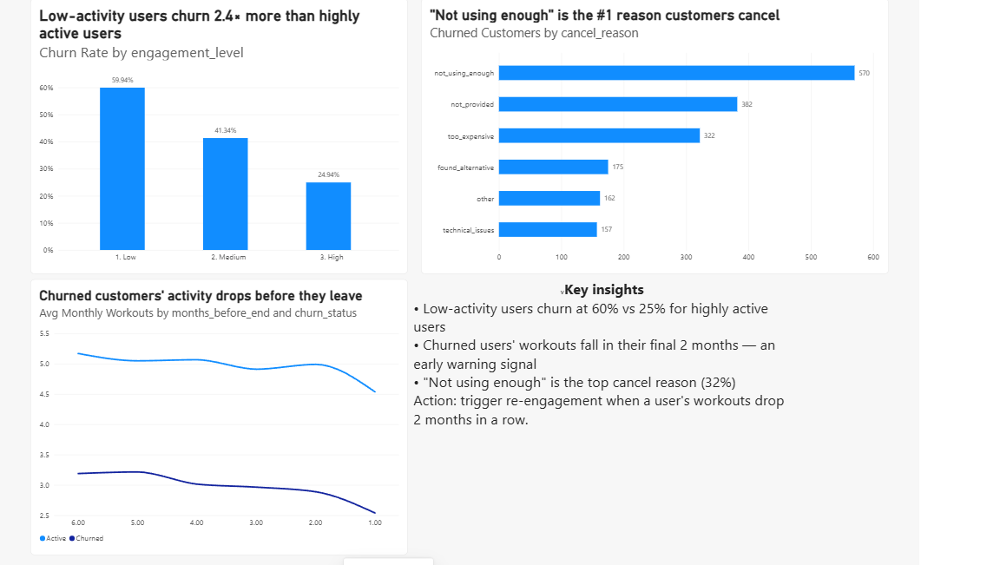

# 📉 Customer Churn Analysis | MySQL + Power BI

An end-to-end data analysis project on a subscription fitness app: raw CSV files are loaded into **MySQL**, profiled, cleaned and analysed with SQL, then presented in an interactive **Power BI** dashboard.

---

## 🎯 Business Problem

The app is losing **42% of its customers**. This project answers:

1. How big is the churn problem, and what does it cost?
2. Which customers are most likely to leave?
3. Why do they leave, and is there an early-warning signal?
4. What should the business do about it?

---

## 📂 Dataset

A simulated subscription dataset with two related tables:

| File | Rows | One row = |
|---|---|---|
| `subscriptions.csv` | 4,200 | one customer (plan, price, channel, device, age group, churn status, cancel reason) |
| `usage.csv` | 30,685 | one customer per month (workouts, minutes, classes booked, support tickets) |

Period: **July 2024 – December 2025**. The tables are linked by `customer_id` (one-to-many).

---

## 🛠️ Tools

- **MySQL 9.7**: data loading, quality checks, cleaning, analysis, views
- **Power BI Desktop**: data model, DAX measures, 3-page interactive dashboard
- **Git / GitHub**: version control and portfolio

---

## 📁 Project Structure

```
customer-churn-analysis-sql-powerbi/
├── data/
│   ├── subscriptions.csv
│   └── usage.csv
├── sql/
│   ├── 01_create_and_load.sql        -- create database + raw tables, load CSVs
│   ├── 02_data_quality_checks.sql    -- profile the raw data
│   ├── 03_data_cleaning.sql          -- build clean tables
│   ├── 04_analysis.sql               -- 11 business questions
│   └── 05_views_for_powerbi.sql      -- views used by the dashboard
├── powerbi/
│   └── customer_churn_dashboard.pbix
├── images/                           -- dashboard screenshots
└── README.md
```

---

## 🔄 Process

1. **Load:** CSVs loaded into untouched `raw_` tables with `LOAD DATA LOCAL INFILE`. Empty values are converted to proper `NULL`s.
2. **Profile:** 10+ quality checks for uniqueness, missing values, inconsistent categories, duplicates, outliers and orphan rows.
3. **Clean:** Built new `customers` and `monthly_usage` tables with primary and foreign keys. The raw data is never modified.
4. **Analyse:** Answered 11 business questions using JOINs, CTEs, `CASE`, and window functions (`ROW_NUMBER`, `RANK`, `CUME_DIST`, running totals).
5. **Visualise:** Connected Power BI to MySQL views, built a star-style model (Customers 1 → * Usage) and DAX measures (Churn Rate, Active MRR, Lost MRR, etc.).

---

## 🧹 Data Quality Issues Found & Fixed

| Issue | Count | Fix | Why |
|---|---|---|---|
| Inconsistent capitalisation in `plan_tier` (`Basic` vs `basic`) | 101 rows | `LOWER(TRIM())` | MySQL's case-insensitive collation hid this. It was detected with `COLLATE utf8mb4_bin` |
| Churned customers with no cancel reason | 382 | Labelled `not_provided` | Deleting them would understate churn |
| Duplicate customer-month rows in usage | 160 | Kept one with `ROW_NUMBER()`, enforced by a primary key | Avoids double-counting activity |
| Missing `minutes_active` | 506 | Kept as `NULL` and flagged | Filling with 0 would wrongly make users look inactive |
| Extreme workout values (max 48/month) | 300 rows above p99 | Kept and flagged with `is_outlier` | Plausible power users. A flag allows filtering |
| `month` stored as text | all rows | Converted to `DATE` | Correct sorting and time analysis |

---

## 📊 Dashboard

### Page 1: Overview


### Page 2: Customer Segments


### Page 3: Engagement


---

## 💡 Key Insights

| # | Finding |
|---|---|
| 1 | **42.1% overall churn**: 1,768 of 4,200 customers, costing **$30.8K per month** in lost recurring revenue (vs $39.5K still active) |
| 2 | **Monthly plans churn at 51.2% vs 26.4% for annual**, almost 2×. Plan tier (basic/plus/premium) makes almost no difference |
| 3 | **Promo-offer customers churn most (50.8%)**, referrals least (33.8%) |
| 4 | The riskiest combination is **promo offer + monthly plan: 63% churn**. The safest is **referral + annual: 20%** |
| 5 | **Engagement is the strongest predictor**: low-activity users churn at **59.9%** vs **24.9%** for highly active users |
| 6 | **Early warning:** churned customers already work out less (~3 vs ~5 per month), and their activity **drops further in their final 2 months** |
| 7 | **"Not using enough" is the #1 cancel reason** (32%). 21.6% of churners gave no reason |
| 8 | Android users churn slightly more (45.0%) than iOS/Web (40.4%). **Age and support tickets show no meaningful effect** |

---

## ✅ Recommendations

1. **Move monthly subscribers to annual plans**, e.g. with an upgrade discount after month 2.
2. **Stop pairing promo discounts with monthly plans**, and offer promo users an annual plan instead.
3. **Trigger re-engagement campaigns** (reminders, challenges, streaks) when a user's workouts drop for 2 months in a row.
4. **Invest in referral programmes**, the channel with the most loyal customers.
5. **Investigate the Android app experience.**
6. **Make the cancel reason a required field**, since 21.6% are currently missing.

---

## ⚠️ Limitations

- The dataset is **simulated**, so patterns are cleaner than real-world data.
- Data ends on 31 Dec 2025, and the newest customers have short observation windows, so tenure-based churn rates for recent signups are biased upward.
- Findings show **association, not causation**. An A/B test would be needed to confirm the impact of the recommendations.

---

## ▶️ How to Run

1. Install **MySQL 8.4+** and run the scripts in `/sql` in order (01 → 05).
   Loading the CSVs needs `local_infile` enabled. See the comments in `01_create_and_load.sql`.
2. Install **Power BI Desktop** and **MySQL Connector/NET**.
3. Open `powerbi/customer_churn_dashboard.pbix` → **Transform data → Data source settings** → point it to your own MySQL server → **Refresh**.

---

## 🧠 Skills Demonstrated

`SQL` · `Data cleaning` · `Data profiling` · `JOINs` · `CTEs` · `Window functions` · `Primary/foreign keys` · `Views` · `Power BI` · `Data modelling` · `DAX` · `Data visualisation` · `Business storytelling`
